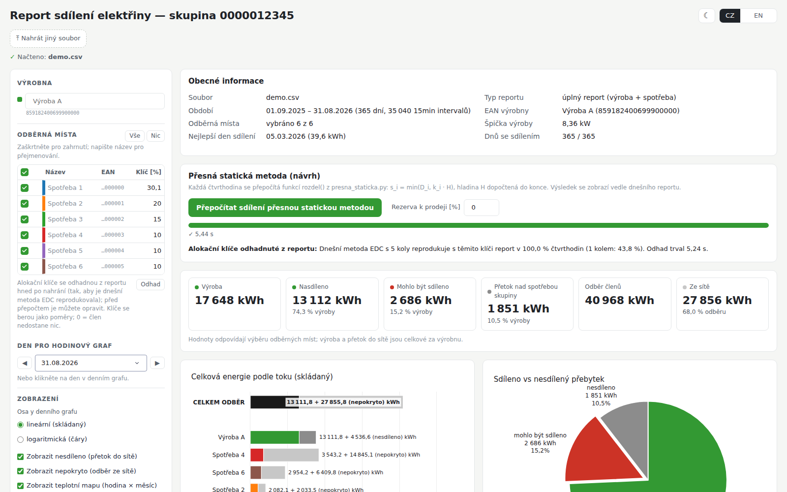
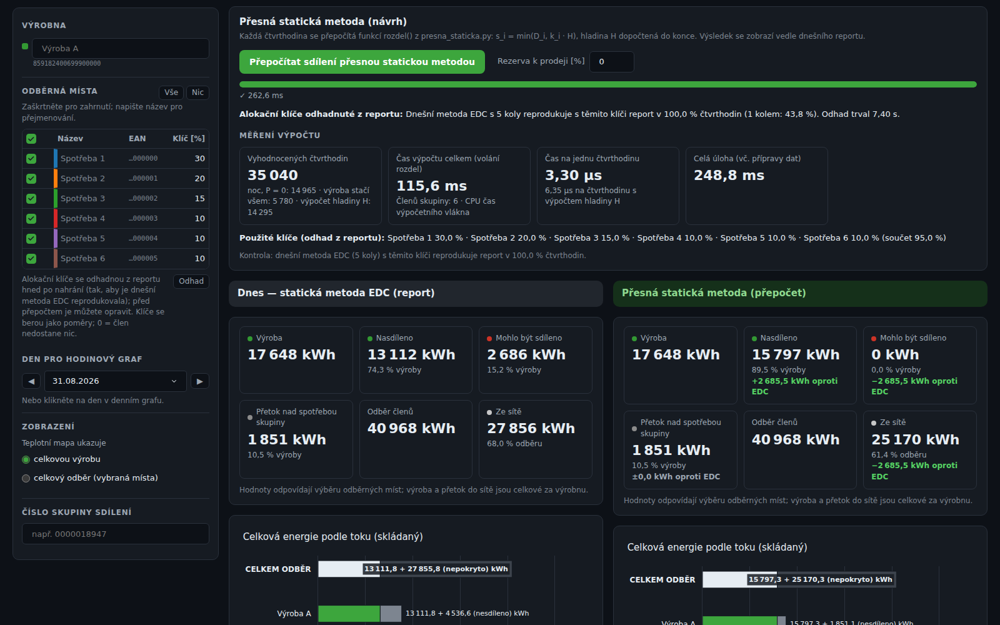
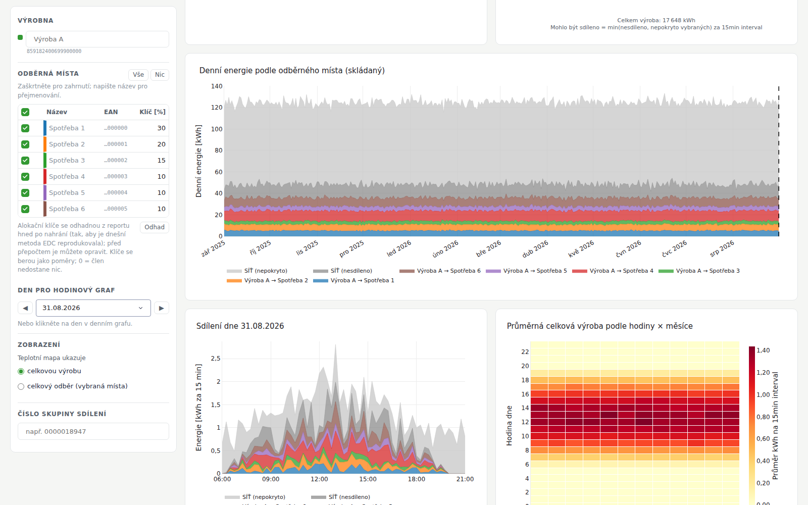

# EDC sharing report

[](https://edc-report.uceeb.cvut.cz/)
[](https://github.com/ottapav/edc-report/actions/workflows/tests.yml)
[](.python-version)
[](requirements.txt)
[](render.yaml)
[](#features)
[](https://github.com/ottapav/edc-report/commits/main)
[](LICENSE)

Interactive web app (Dash) that displays the electricity-sharing data of a Czech sharing
group. The input is the CSV report generated on [edc-cr.cz](https://www.edc-cr.cz), the portal
of the *Elektroenergetické datové centrum* (EDC). Upload the CSV and you get the group's
sharing at a glance. The app also recomputes the whole period with the proposed **exact
static method** (`presna_staticka.py`) and shows the result of the approximate static method (EDC's current implementation) and the exact one side by side,
with the computation timed per 15-min interval.

The interface is available in Czech, English and German (switch in the top bar; the explanatory article is available in the same three languages).

**Live:** <https://edc-report.uceeb.cvut.cz/> · explanatory articles ([`clanky/`](clanky/README.md)):
<https://edc-report.uceeb.cvut.cz/clanky/do-posledni-kwh/> (Czech), [`…/en/`](https://edc-report.uceeb.cvut.cz/clanky/do-posledni-kwh/en/), [`…/de/`](https://edc-report.uceeb.cvut.cz/clanky/do-posledni-kwh/de/);
the billing by contribution (draft, Czech): <https://edc-report.uceeb.cvut.cz/clanky/spravedliva-cena/>

> **Česky:** Webová aplikace, která zobrazuje data o sdílení elektřiny z CSV reportu
> vygenerovaného na portálu edc-cr.cz. Po nahrání CSV ukáže
> souhrny, denní a hodinové grafy, teplotní mapu a podíl, který „mohl být sdílen“.
> Z reportu odhadne alokační klíče (přibližná statická metoda EDC s 1 nebo 5 koly, i pro velké skupiny).
> Jedním tlačítkem přepočítá sdílení přesnou statickou metodou a porovná ji s dneškem.
> Záložka Vyúčtování spočítá vyúčtování sdílené elektřiny podle přínosu (Shapleyho hodnota)
> (zadáte ceny od prodejce a výkupní ceny výroben).
> Třetí záložka ukáže, co by vyneslo prodávat celý přebytek na spotovém trhu (denní trh OTE)
> místo sdílení: ceny OTE se stáhnou samy, srovnání po členech, dnech a měsících.
> Souhrn lze stáhnout jako Excel nebo vytisknout do PDF.
> Rozhraní je v češtině i angličtině, se světlým i tmavým režimem.



## Contents

- [Features](#features)
- [Quick start](#quick-start)
- [Using the app](#using-the-app)
- [How the allocation keys are estimated](#how-the-allocation-keys-are-estimated)
- [Exact static method and timing](#exact-static-method-and-timing)
- [Billing by contribution (the Shapley value)](#billing-by-contribution-the-shapley-value)
- [Share or sell on spot](#share-or-sell-on-spot)
- [Architecture](#architecture)
- [Performance](#performance)
- [Deployment on Render](#deployment-on-render)
- [Configuration](#configuration)
- [Tests](#tests)
- [Limitations](#limitations)
- [Data and privacy](#data-and-privacy)
- [License](#license)

## Features

**Report of the approximate static method (EDC)** (the figures of `plot_energy_sharing.py`, interactive):

* **General information and headline figures:**
  * facts: period, 15-min intervals, producer, peak production, best day;
  * energy: production, shared, *could have been shared*, surplus above group demand;
  * consumption: members' consumption and energy from the grid.
* **Total energy by flow:** stacked bars per member (shared | unmet) and for the source
  (shared | shared to unticked members | unshared).
* **Pie "where the production went":** shared to the ticked members, shared to the unticked
  ones (hatched), *could have been shared* (min(unshared, unmet of the ticked members) in the
  same 15 min), and surplus nobody could use. The slices always add up to the production,
  whatever is ticked. For a subset of members that min is only an upper bound (as if the
  ticked members got the whole surplus), so the tile says "at most"; once the exact method
  has been computed, *could have been shared* is what it really adds to the ticked members,
  and the tiles, the pie, the Σ row of the comparison table and the sharing-error box agree.
* **Daily energy:** stacked areas (linear axis) with the grid flows, unshared and unmet, and
  the hatched energy that went to unticked members. **Click a day** to select it.
* **Sharing on the selected day:** 15-min steps from 06:00 to 21:00, always directly under the
  daily plot. The y axis fits the selected day and is shared by both methods, so they compare on one scale.
* **Heatmap hour × month:** the **total production** (independent of the selection) or the
  **total consumption** of the ticked members. A part report has neither, so it shows the
  shared energy. Neither depends on the sharing method, so next to the exact method it is
  shown once. The choice between them is in the panel on the *Sharing* tab only.
* **Per-member table:** consumption, shared, unmet, coverage and data availability.

**Selection panel:**

* Tick members on or off, rename them, and edit their allocation keys. All of this happens in
  one grid, so a group of hundreds of members stays fast.
* ◀ date ▶ for the hourly plot.
* Heatmap metric (production / consumption).
* Group ID for the title.

**Exact static method (proposal):**

* **Keys:** estimated from the report right after upload. You can check and correct them
  before the recompute. They are checked as you type: no key may be negative (the cell turns
  red), and they may add up to at most 100 % (empty cells count with their estimate);
  otherwise the recompute does not start and the card says why.
* **Same keys on both sides:** with keys other than the estimate (or a reserve), the
  recompute also replays the approximate static method (today's EDC rounds) with them, and
  the left column shows that replay instead of the report ("EDC replayed with these keys").
  Tiles, pie, comparison table and the sharing-error box then compare the two methods for
  the same keys; **Odhad** and a new recompute bring the report back. A member with key 0
  gets nothing in either method.
* **Recompute:** one button runs `rozdel()` for every 15-min interval, with a progress bar.
* **Side by side:** the approximate static method (EDC) and the exact method, with shared axes, differences to EDC in
  the tiles, and a per-member comparison table. The two columns share the rows of one grid
  (CSS subgrid): every card sits next to its counterpart at the same height, tile values are
  level, the "by flow" charts keep each member on the same row, and paired plots get the same
  height and number of legend rows, so their x axes line up.
* **Sharing error:** when the recompute is done, a callout gives the error of the approximate static method (EDC)
  algorithm as a percentage of the maximum sharing (what the exact method shares), with the
  kWh missed.
* **Timing:** the number of intervals evaluated, total time, and time per interval, split by
  the method's fast paths.

**Billing by contribution (the Shapley value; proposal; the *Billing* tab):**

* **Prices:** each member's supplier price (the *Price* column of the grid, next to the keys)
  and each producer's feed-in price (the producers' grid above it); the empty cells take the
  **base** supplier and feed-in prices of the billing card (the same fields are in the spot
  card). Every number is typed the same way, with a decimal comma or point. The price
  columns show on the *Billing* and spot tabs only, the tabs that use them; hidden on the
  *Sharing* tab they keep what was typed.
* **The whole group:** the billing is always the whole group's; ticking members off in the
  panel changes the energy figures of the *Sharing* tab, not the billing (nor its export).
* **Several producers:** the producers share as a pool (any producer can supply any member);
  each has its own feed-in price.
* **Compute:** one button computes the exact Shapley values over the whole report in the
  background, with a progress bar.
* **Its own tab:** the *Sharing*, *Billing* and *Sharing × selling on spot* tabs sit side by
  side. The *Billing* tab shows only the billing, over the full width: its card (prices,
  button, progress; how long it took and how is the hint of the "✓ … s"), and once computed:
  * four **tiles**: the benefit (of the best possible, and what the EDC sharing missed), the
    producer's and the members' shares, what the producer receives (on average per kWh, and
    the feed-in value in it);
  * the **settlement table**: per member the shared energy, its value at the supplier price,
    the fair share of the benefit, the payment to the producer and the effective price per
    kWh; per producer the energy it shared, its income, its share and the feed-in value it
    gave up. The price column only when the prices differ; with one supplier and one feed-in
    price for everybody a line above the table says them. Below it how a payment is
    computed, why one is negative (when one is) and that it is a proposal for the contract;
  * **where the benefit went** (pie) and the **producer's share by month** (bars, with half
    and the whole period as lines): scarce production pays the producer more;
  * on demand (**Over time**, collapsed): the daily share (click a day) and the selected day
    in 15-min steps.
  The columns of the EDC report and the exact method belong to the *Sharing* tab.

**Sharing × selling on spot** (third tab; all report):

* The question is who gets what. With sharing, the members pay the producers as the
  **billing by contribution** says (the Shapley value): a producer gets its shared
  electricity at the feed-in price plus its fair share of the benefit, and the spot price
  for the unshared surplus (sharing and selling the rest on spot go together); a member saves its fair share against its supplier price.
  On spot, the producers get the spot price for the whole surplus and the members buy
  everything from their supplier (they save nothing). The group is the sum of both sides.
* The answer first: a box says whether sharing pays for the producers (and what the members
  save) and for the group, what the shared electricity would get on spot (the price sharing
  must beat, usually well below the average spot price), whether offering only a share of
  the production for sharing pays more, and how much choosing every 15 min could add at
  most.
  Without a billing for the prices typed, the box speaks for the group. The card's button
  *Compute the billing by contribution* is always there and enabled only then (and not while
  the billing runs), so typing a price does not move the card; the billing's progress shows
  in the card.
* **Share offered for sharing** (group): the value for 0, 10, …, 100 % of the production
  offered for sharing, shared by today's EDC method with the keys of the panel (estimated
  or typed), the rest on spot; 0 % is all on spot, 100 % the report's sharing.
* The OTE prices of the report's period are downloaded when the tab opens (after a failure,
  the next time it opens); the comparison then follows every price, fee or tick typed, with
  no button.
* Inputs: the supplier prices of the panel, with the base price for the empty cells (the
  same field as in the billing card), the fee for selling on spot in CZK/MWh, and whether
  the producer stops selling at a negative price; the feed-in prices only for the billing.
* Tiles: producers with sharing and on spot, what sharing brings them, what the members save,
  the group's gain (the shared electricity at the supplier prices against spot), the surplus
  at negative prices.
* Figures: who gets what (producers and members, stacked) for sharing (the rest on spot) and
  all on spot; the group's value by the share offered for sharing; per participant
  (producers' income, members' savings) with sharing and on spot; per day what sharing brings
  the producers and the members (click selects the day); the selected day's spot price
  against the supplier price, with the surplus below; the prices per month (with what the
  shared electricity got on spot).
  Tables per producer and per member, each producer's break-even price.

**Export:**

* **Summary as Excel** (*Download summary* in the panel): one `.xlsx` with the numbers of the
  page for the current selection (ticked members, names, language), as numbers rather than
  text, whichever tab is open: everything computed for the report. Sheets: *Summary* (facts; energy tiles with the shares under them, for every
  column the page can show: the EDC report, after the recompute the exact method and, with
  keys other than the report's, EDC replayed with them; sharing error, keys and reserve;
  billing totals; key estimate), *Destinations* (the per-destination table), *Comparison*
  (after the recompute), *Billing* (after the billing, always the whole group; when the
  prices have changed since, a red line above its tables says so, as the page does), *Spot*
  (once the OTE prices are
  there: totals, per member and producer, per month) and *Daily* (the series of the daily
  plots per day, for each of those columns).
* The values are the page's: the same sources, and percentages and money in full
  precision with the page's number of decimals as the cell format, so Excel shows the
  figure the page shows.
* EANs are shortened to their last three digits as on the page; *Full EANs in the export*
  writes them whole.
* **Print / PDF** prints the open tab (to paper or PDF via the browser), with its figures,
  without the panel and the buttons, one column per page width; the billing's course over
  time only when it is open. A dark page is printed in the light theme and
  switched back afterwards.

**Interface:**

* EANs are shown by their last three digits only (anonymity, room in the panel).
* CZ / EN / DE.
* Light and dark mode: the default follows the system, and the ☾/☀ icon switches and
  remembers the choice.
* Works on a phone.



## Quick start

```bash
git clone https://github.com/ottapav/edc-report.git && cd edc-report
python -m venv .venv && . .venv/bin/activate   # Python 3.11 (see .python-version)
pip install -r requirements.txt
python app.py                                  # http://127.0.0.1:8050
```

To run it exactly as in production:

```bash
gunicorn app:server -c gunicorn.conf.py        # listens on $PORT (default 8050)
```

## Using the app

1. **Upload** the CSV report generated on edc-cr.cz (file name like
   `Export-dat-…-report-….csv`). Both report layouts are detected from the header:
   * **all report** (`IN/OUT-<ean>-D` for each producer, `IN/OUT-<ean>-O` for members) carries
     production and consumption and enables everything. With several producers the report
     does not say which producer supplied whom, so the shared energy is shown as one
     **pool**; the keys are estimated per pair producer → member as EDC sets them, and the
     exact method shares the pool with keys made of them (see
     [Several producers](#several-producers-pair-keys-and-the-pool)); the page says so in
     the exact method's card and in the column titles;
   * **part report** (`<ean>-<ean>` columns) has shared energy only: no pie, no recompute.

   A few rows more than a day away from the rest of the report (say a few intervals of
   another month pasted at the end) are left out, and the *Notes* under the general
   information say which.
2. The report appears immediately, and the **allocation keys are estimated in the
   background**. A summary shows which EDC method explains the report (1 or 5 rounds) and
   how many 15-min intervals it reproduces. Keys that the report cannot pin down exactly are
   marked, and hovering shows the range of equally consistent values.
3. **Check the keys** against the contract and correct them in the grid if needed; **Odhad**
   restores the estimate. Keys act as ratios in the exact method, and 0 means the member gets
   nothing. Negative keys and a sum over 100 % are refused. An optional *reserve for sale* is
   passed to `rozdel(..., rezerva=)` (and taken off the production of the replayed
   approximate method too).
4. **Recompute.** The second column appears next to the EDC report, and the timing card shows
   the computation.
5. **Explore:**
   * click a day in either daily plot, or use ◀ ▶, to see it in 15-min steps;
   * untick members to see the rest of the group;
   * switch the heatmap between total production and total consumption.
6. **Export** the summary to Excel, or print the report to PDF (the *Export* section of the
   panel).



## How the allocation keys are estimated

The CSV has no keys, but it contains what the approximate static method (EDC) did with them. In every
round each member gets `min(remaining demand, floor(k_i · P_r))`, where `P_r` is the production
left at the start of the round. Groups up to 100 EAN get 5 rounds, larger groups one round.
`keyfit.py` inverts this. The result is a **rough estimate**: it need not be optimal, but it
must never contradict the report.

**Rules that always hold**

* A member that never receives anything while it has demand and there is production gets
  **key 0**. The report only bounds its key from above, and a nonzero key would contradict it.
  A member without any demand while there was production also gets 0 (no phantom key).
* A member that is always fully covered gets the smallest key that keeps it covered.
* The keys never sum above 100 %, and the match with the report (the share of 15-min intervals
  that the approximate method reproduces with these keys) is always measured on **every** interval.

**How it works**

* **Every interval where a member is not fully covered bounds its key.** Such a member was
  never capped, so it received exactly `floor(k_i · P_r)` in each round:
  `sum_r floor(k_i · P_r) = s_i`. That pins `k_i` to a small interval, found exactly by
  bisection. An interval where the member is fully covered gives a lower bound.
* **The key is the value consistent with the most intervals**, on the 0.01 % grid of EDC
  keys. A rounder value nearby (1 %, 0.5 %, …) wins only when the separating intervals do not
  clearly favour the finer one. This absorbs the ~1 % of report rows that do not follow the
  model, without inventing round numbers.
* **One round is separable**, because each member depends only on its own key, so all keys
  come out in one pass over every interval. This covers the groups above 100 EAN.
* **Five rounds couple the members** through `P_r`. The bounds are iterated to a (nearly) fixed
  point from a rank-1 estimate, which needs no `P_r`, because two members short in the same
  interval both got their key's share of the same productions. The fit is then settled by
  replaying the method: moving single keys, and moving all keys together (rounded or rescaled).
  If the match is still below 98 %, a second, uniform start is tried and the better fit kept.
* **The five-round search is rough on purpose.** It works on at most 1 500 informative
  intervals, evenly spread over the period (every member keeps up to 300 of its own), with a
  few iterations and one sweep; small groups (rows × members ≤ 60 000) get the full search on
  all intervals. After 20 s (`FIT_BUDGET_S`) it returns the best keys found so far and the
  page says so. This is as good as the full search on the benchmark, in a tenth of the time.
* Both round counts are tried (5 only up to 100 members, and not when one round already
  explains the report), and the one that reproduces more intervals wins.

For every key the app also returns the **range of values the report fits equally well**. A key
is marked when that range is wider than 0.2 pp or 5 % of the key. Typical causes are a member
that is almost always fully covered (then only a lower bound is known) or one with no data.

**Accuracy and time**, measured by `python bench/keyfit_bench.py` on synthetic one-year groups
(35 040 intervals): EDC shares from known keys, 1 % of intervals perturbed, one CPU core.
"truth" is what the true keys reproduce, so a fit "as good as the truth" cannot do better.

| Members | Keys | EDC rounds | Match with the report (truth) | Keys equal to the true ones | Time |
|---|---|---|---|---|---|
| 20 | random, 0.01 % steps | 5 | 99.0 % (99.0 %) | 85 % | 2 s |
| 60 | whole percent | 5 | 99.0 % (99.0 %) | 90 % | 5 s |
| 60 | random | 5 | 99.0 % (99.0 %) | 92 % | 7 s |
| 100 | random | 5 | 99.0 % (99.0 %) | 99 % | 18 s |
| 150 | random | 1 | 99.0 % (99.0 %) | 100 % | 0.5 s |

The real group 0000018947 (5 members, 1 year) comes out as exactly 50 / 10 / 10 / 10 / 10 %,
reproducing 99.2 % of intervals, in about 3 s. Keys that differ from the true ones are
members whose value the data cannot pin down (every value in the reported range reproduces the
report equally well). The summary shows the match and warns below 95 %, so check those keys
against the contract. On the free Render instance (less than 1 CPU) expect several times
longer.

## Exact static method and timing

`presna_staticka.py` is the reference implementation (unchanged). Each member gets
`s_i = min(D_i, k_i · H)`, with the level `H` computed to the end, so everything that can be
consumed is shared while the keys hold. `recompute.py` calls `rozdel()` for every 15-min
interval of the report and builds a second report in the same structure, so every figure and
table works for both.

### Several producers: pair keys and the pool

**EDC's method for several producers** (EDC methodology): every pair producer → member has
its own key, and every member takes from its producers in an order of priority. In every
round each member, in priority order, gets `min(remaining demand, floor(key × supply of the
producer at the start of the round))`; the producers' supplies drop only after the round.
`keyfit.replay_edc_multi` replays it (it reproduces the methodology's worked example; with
one producer it is the single-producer replay). The order of the producers in the report is
taken as their priority.

**Estimating the pair keys.** The report gives what every member received and what every
producer shared, not the flows of the pairs; the producers' changing shares of the
production over the day (east/west roofs, clouds) tell the pair keys apart.
`keyfit.estimate_pair_keys` starts from one key set for the pool, fits the pair keys to
both the members and the producers (Levenberg–Marquardt on a relaxed replay), then uses the
exact equations of members not fully covered and settles on the 0.01 % grid by the replay,
also moving a member's key between two producers. On synthetic groups built by the
methodology it reproduces 89–99 % of the intervals with pair keys within 0.7 pp, where one
key set for the pool reproduces 45–67 %. Producers that produce alike stand in for each
other: their pair keys are uncertain, their weighted sum is not. The keys can be checked and
typed from the contract in the *Keys per producer* grid of the exact method's card; the
members' key column in the panel then shows the pool's key over the period.

**The exact method on the pool.** The production of all producers is shared as one pool,
as if from one big producer. In every interval each member's key is made of its pair keys:
`k_j(t) = Σ_i (K[i, j] / Σ_l K[i, l]) · P_i(t) / P(t)` - every producer's keys as ratios,
weighted by what the producers produce then (morning: mostly the east roof's keys;
afternoon: the west roof's). The keys are ratios because EDC with endlessly many rounds
gives away all of a producer's production whatever its keys add up to; so when nobody is
filled up, every member gets exactly what EDC's method for several producers gives after
endlessly many rounds. Where the two differ: a member that is filled up leaves its share to
*all* members of the pool, not only to the other members of the same producer; and the pool
ignores pair keys of 0 (a producer's energy may reach a member that has no key with it), so
it always shares the maximum, `min(production, demand of the members with a key)`, where the
pair rule may not (that would be a maximum-flow problem). The pool's surplus goes back to the
producers in proportion to their production. The page says it is a pool in the exact
method's card (before the computation), next to the key estimate and in the column titles;
the export too, with a sheet of the pair keys.

**Explanatory articles.** Each article has its own folder in [`clanky/`](clanky/README.md),
for a broad audience (written for TZB-info, UCEEB ČVUT):
[`do_posledni_kwh/`](clanky/do_posledni_kwh/README.md) explains the approximate and the exact
static method, the pool mode for several producers and the results for one real group (Czech,
English, German); [`spravedliva_cena/`](clanky/spravedliva_cena/README.md) explains the billing
by contribution (Shapley value; Czech, a draft). The app assembles an article from its folder
(`clanek.html`, translations `clanek.en.html` / `clanek.de.html`, figures from its
`schemata.py`) and the shared style `clanky/styl.css` on every request, serves it at
`/clanky/<address>/` (`…/en/`, `…/de/`; the old `/clanek/…` addresses redirect to the first
article) and links each one above the button of its card, in the interface language: the
first from the *Exact static method* card, the second from the *Billing by contribution*
card (Czech in every language until translated). An edit in the repository is what the app
shows.

**Timing.** The loop runs in a forked worker process: it gets a whole core, and the web
server's threads do not disturb the measurement. It is timed with that process's CPU clock:

* the garbage collector is told to ignore the inherited server heap (`gc.freeze()`), otherwise
  copy-on-write faults were billed to `rozdel()`;
* intervals are grouped by the method's fast paths (night P = 0; production covers everyone;
  level H computed) and each group is timed as one batch, so there is no per-call timer
  overhead.

The page reports the number of evaluations, the total time, the time per interval (overall
and with H computed), and the whole job.

For the real group (5 members, 35 040 intervals), 22 333 are night, 3 727 have enough for
everyone and 8 980 need H. That takes 50–65 ms in total, about 1.5–1.9 µs per interval and
about 4.5 µs with H. For 150 members and one month it takes about 70–80 ms and 25 µs per
interval. Numbers vary with the machine; Render instances have less than one CPU.

## Billing by contribution (the Shapley value)

`billing.py` splits the benefit of sharing between the producers and the members by the
Shapley value. The benefit of a kWh that producer *i* shares to member *j* is `p_j − f_i`
(supplier price minus feed-in price). The keys do not enter the Shapley value: they decide
who got the energy, the Shapley value decides who deserves the money.

**The game.** In every 15-min interval a coalition is worth what it could save with the best
sharing, the producers' surplus shared as a pool: the cheapest production goes first to the
members with the highest price. With all distinct prices sorted, λ_0 < λ_1 < …,
`v(S) = Σ_k Δλ_k · min(G_k(S), D_k(S))`, where layer *k* holds the producers with
`f ≤ λ_k` (surplus `G_k`) and the members with `p ≥ λ_{k+1}` (demand `D_k`). Shapley values
add up, so the year is the sum of the intervals and the layers.

**Exact algorithm** (energies in hundredths of kWh, like EDC data, so nothing is rounded):

* nothing to share: nothing; a layer with one producer that covers its demand: every member
  gets `d_j / 2` of it, the producer the rest; a layer with one member that takes all its
  surplus: every producer gets `g_i / 2` (closed forms, all such intervals at once);
* otherwise, with the balance `Z = D(S) − G(S)` and `H(a) = Σ_{s≤a} P(Z ≤ s)`:
  `φ_j = ∫₀¹ H₋ⱼ(−1) − H₋ⱼ(−1 − d_j) du` for a member and
  `φ_i = g_i − ∫₀¹ H₋ᵢ(g_i − 1) − H₋ᵢ(−1) du` for a producer (Owen's multilinear extension).
  The integrand is a Bernstein polynomial with coefficients in [0, d_j], so Gauss–Legendre
  needs far fewer than m/2 nodes: a rigorous error bound (Bernstein ellipse) picks the smallest
  even count for 10⁻¹³ relative error (12 nodes for 20 players, 46 for 150);
* one DP per node gives the distribution of *Z*: the members sorted by price (every layer is
  a prefix of them), then each layer's producers; node 1 − u is the mirror image of u, so
  half the nodes need a DP;
* leaving a player out needs no deconvolution: a finite geometric series turns `H₋ᵢ` into
  lookups in *H*, summed over the player's layers with weights Δλ (a member is in the first
  layers, a producer in the last ones).

The approach — Owen's integral over u plus a DP of the distribution of a weighted sum — is the
one of F. Illés, *Linearly representable games and pseudo-polynomial calculation of the
Shapley value* ([arXiv:2205.12324](https://arxiv.org/abs/2205.12324)), for games whose value
depends only on a sum of player weights. Here `min(G, D) = D − (D − G)⁺` is an additive game
plus such a game; the code extends it with signed weights (producers), price layers, a
rigorous node count for the quadrature and the leave-one-out series. Energy-sharing papers
with batteries (e.g. [arXiv:1903.11047](https://arxiv.org/abs/1903.11047),
[arXiv:2301.00174](https://arxiv.org/abs/2301.00174)) estimate the Shapley value by sampling,
because there the value of each coalition comes from a simulation or optimisation over time.

The suite checks the result against brute force over all coalitions (one and several
producers, mixed prices, members without demand, prices below the feed-in price) to 10⁻⁹ Kč.

**Settlement.** The Shapley values of the best sharing are scaled to the benefit the EDC
report really achieved, `Σ p_j · s_j − Σ f_i · q_i` (`s_j` shared to member *j*, `q_i`
shared by producer *i*). Member *j* pays `p_j · s_j − share_j` (in whole haléř); the payments
make a pool from which each producer gets the feed-in value of its shared energy plus its
share (whole haléř, adding up to the payments). The page shows how much of the best possible
benefit the report achieved.

**Plots.** The computation also keeps the Shapley values of every 15-min interval with
production (float32, about 4 bytes per member and interval), scaled the same way, so the
monthly, daily and hourly figures add up to the settlement.

**Time** (one core, synthetic groups, `compute_shapley`):

| Members | Producers | Period | Distinct prices | Time |
|---|---|---|---|---|
| 5 | 1 | 1 year | 4 | 3 s |
| 5 | 3 | 1 year | 5 + 3 feed-in | 19 s |
| 20 | 1 | 3 months | 19 | 6 s |
| 50 | 1 | 1 month | 45 | 17 s |
| 150 | 1 | 1 month | 1 | 38 s |
| 150 | 3 | 1 month | 1 + 3 feed-in | 1.6 min |
| 150 | 1 | 1 month | 113 | 3 min |

The cost grows with the number of members, the size of the production and demand in
hundredths of kWh, and the number of distinct prices. With several producers the closed
forms rarely apply, so more intervals need the quadrature. Expect several times longer on the free Render instance.

## Share or sell on spot

`spot.py` compares the report's sharing with selling the producers' whole surplus on the
OTE day-ahead market.

**Prices.** The OTE public web service (SOAP, `https://www.ote-cr.cz/services/PublicDataService`,
no registration) gives the Czech day-ahead price:

* from delivery day 1 Oct 2025 the 15-min price (`GetDamPricePeriodE`, PT15M) in EUR/MWh,
  converted with OTE's EUR rate of the day (`GetDamIndexE`; the ČNB rate of the month when
  OTE has none);
* before that the hourly price (`GetDamPriceE`) in CZK/MWh, the same for the four quarters
  of the hour.

One call returns at most 31 days, so a year takes about 25 calls, four at a time (a few
seconds). Period *k* of a day starts (k − 1) × 15 min after midnight in absolute time, so
the 23- and 25-hour days land on the report's local wall clock. Days that are over stay
in memory for every user (public data). Intervals without a price are left out of both
sides, with a note. The server needs outbound HTTPS to www.ote-cr.cz (and api.cnb.cz for
the fallback rate); when OTE cannot be reached the card says why, and opening the tab
again tries again.

**Comparison.** Sharing and selling the rest on spot go together: what the members do not
take is sold on spot either way. With sharing, a member's shared kWh is worth its supplier
price *p* (it did not buy it); every other kWh of the surplus earns *v* = spot price − fee
(with curtailment never below 0), with sharing and on spot alike. Per 15 min the group gains

    G = Σ_j (p_j − v) · shared_j,

which is the value with sharing minus the spot revenue. So sharing pays while the supplier
prices are above what the shared electricity would get on spot (Σ v · shared / Σ shared):
that is mostly the price at times of high production, often well below the average spot
price. The feed-in price matters only for the billing by contribution (who gets what).

**Share offered for sharing.** Offering only a share *s* of the production: *(1 − s) · P*
goes to spot in every 15 min, the rest is shared by EDC's method with the same keys and
rounds (`keyfit.replay_edc`, several producers `replay_edc_multi` with the pair keys), and
what nobody takes goes to spot too; for *s* = 0, 10, …, 100 % (≈ 2 s for 150 members over a
year, then memoised). The value is Σ_j p_j · shared_j + Σ v · (the rest), each kWh at the
spot price of its interval. The replay is anchored to the report member by member and
interval by interval, so 100 % is exactly the report's sharing and 0 % exactly all on spot.
Choosing every 15 min where each shared kWh goes (spot when spot − fee is above the
member's supplier price) gives an upper bound; EDC sharing cannot do that.

**Who gets what.** With the billing by contribution for the same prices, the billing's
Shapley values per 15 min are summed over the compared intervals and scaled to the benefit
realized there (Σ p · shared − Σ f · supplied), as its settlement does over the whole report:
with a spot price everywhere the factor is 1 and the members' savings are the billing's
shares. A producer gets f · its shared energy + its scaled share for the shared electricity, so
the producers get exactly what the members pay, and the spot price for its unshared
surplus; with nothing to gain (supplier prices not above the feed-in prices) the
members pay their supplier price and the producers share it, as the settlement does.

A producer's **break-even price**
of the shared electricity is what that electricity would get on spot (Σ v · supplied /
supplied): with an internal price between it and the members' supplier price both sides
are better off than on spot. The
members' shares and payments are internal transfers and do not enter G; after the billing
by contribution the price window tile also shows what the billing pays per kWh.

## Architecture

The code is in three layers. The domain modules know nothing about the web page; the
server state keeps uploads and running computations; the UI builds the page and its
callbacks from both.

| Layer | File | Role |
|---|---|---|
| Domain | `edc_data.py` | CSV parsing (both layouts), per-member frames keyed by EAN, statistics; memoised derived data |
| | `keyfit.py` | Replay of the approximate static method (EDC) (numpy, in blocks), rough key estimation for 1 and 5 rounds |
| | `presna_staticka.py` | Reference implementation of the exact static method |
| | `recompute.py` | Exact static recompute (the `rozdel()` loop in a child process), timing, sharing error |
| | `billing.py` | Shapley values of the billing (exact, price layers), the settlement in Kč, values per 15 min |
| | `spot.py` | OTE day-ahead prices (SOAP client, chunks, cache, DST-safe alignment) and the comparison of sharing with selling the surplus on spot |
| | `procjob.py` | Runs a function in a forked child with progress, cancellation and a time limit |
| | `export.py` | The summary as an Excel workbook (openpyxl): tables of numbers from the same sources as the page |
| | `figures/` | Plotly figures: `base.py` themes, member colours and the shared chart shapes (stacked bars, pie, stacked areas by day and within a day, heatmap, pairing of the two columns); `energy.py` the report in kWh; `money.py` the billing in Kč; `spot.py` the spot comparison in Kč |
| | `i18n.py`, `i18n_de.py` | CZ/EN/DE strings, number and date formatting |
| Server state | `config.py` | Settings from environment variables |
| | `store.py` | Uploaded reports and their results (key estimate, recompute, billing, spot prices): newest `EDC_CACHE_MAX` and at most `EDC_CACHE_MB` kept, deleted after `EDC_REPORT_TTL_S` without use |
| | `jobs.py` | Background computations: queue, child process, cancellation, progress; the spot prices are fetched without a CPU slot |
| UI | `ui/layout.py` | The page and its three tabs; the computation cards come from one `job_card()` with ids `<kind>-btn`, `<kind>-progress`, … |
| | `ui/members.py` | The members grid (tick, name, key, price) and reading what was typed in it |
| | `ui/widgets.py`, `ui/views.py` | Tiles, facts, tables, result summaries (pure functions of the data) |
| | `ui/panel.py` | Callbacks: labels (one table of id, property and string), theme, upload, grid buttons |
| | `ui/compute.py` | Callbacks of the computation cards: start, one shared progress poll, results |
| | `ui/report.py` | Callbacks of the report: the two columns (the tab chooses the right one), the hourly plot, the selected day |
| | `ui/spot.py` | Callbacks of the spot tab: the tabs, fetching the prices, the comparison |
| | `ui/export.py` | Callbacks of the export: the workbook download, printing |
| App | `app.py` | Creates the Dash app, `/healthz`, optional basic auth |
| | `assets/style.css` | Styles, light/dark variables (Dash loads it automatically) |
| | `assets/favicon.svg`, `.ico`, `apple-touch-icon.png` | App icon in ČVUT colours (blue Pantone 300, amber Pantone 130); the PNG/ICO are rendered from the SVG |
| | `assets/version.js` | Offers a reload when the server's code version (`X-App-Version`) is not the page's: after a deploy a page loaded before it calls callbacks the new server may not have, and its buttons would do nothing |
| | `gunicorn.conf.py`, `render.yaml`, `.python-version` | Deployment |
| Checks | `tests/` | pytest suite (synthetic data, no real CSV needed) |
| | `.github/workflows/tests.yml`, `requirements-dev.txt` | CI: the suite on every pull request and push to `main` |
| | `bench/keyfit_bench.py` | Reproducible accuracy / time benchmark of the key estimate (synthetic data) |

**One process on purpose.** An upload, its key estimate, a running recompute and its progress
live in the memory of one process, and every request of that browser session must reach it.
`gunicorn.conf.py` therefore pins **one worker** (ignoring `WEB_CONCURRENCY`) with threads, and
never recycles it (`max_requests = 0`).

This is the failure mode fixed in robopid-simulator: there, with two workers, the progress
polls of a job reached the worker that did not start it, and the button looked dead. More
workers here would need a shared store such as Redis, not a bigger worker count.

**Background jobs** (`jobs.py`). Key estimation (after upload), the `rozdel()` loop of the
recompute and the Shapley values of the billing each run in a **forked child process**
(`procjob.py`), started from a job thread. The web
server's request threads therefore stay free for progress polls and page renders, the child
gets a core of its own, and its arguments (big numpy arrays) are shared with the parent by
`fork` instead of being pickled; only progress messages and the small result travel back.
At most `EDC_MAX_JOBS` jobs run at once, and the rest wait in a visible queue. The browser
polls every 200 ms, and only the poll callback draws the progress bar and the button state.
Because a job is a process, it can be **cancelled**, and the slot is freed at once:

* when its report is gone: the same browser uploaded another file, or the report was evicted
  from the store (a job checks this itself, so the store needs no knowledge of jobs);
* when the page stops polling for `EDC_JOB_IDLE_S` seconds (tab closed). A waiting job leaves
  the queue the same way;
* when a key estimate runs longer than `EDC_FIT_TIMEOUT` seconds. It stops itself after about
  20 s with the best keys so far, so this is only a safety net;
* when any job has worked for `EDC_JOB_TIMEOUT_S` seconds (default 30 min);
* when the same report starts another job of the same kind (the new result replaces it).

**Limits against overload.** Anyone can send the callbacks the page sends, with or without
its buttons, so the server limits what one client can take. At most `EDC_MAX_PENDING` jobs are
unfinished at once; more are refused with "server busy", and a report has one job of a kind
at a time. An upload is parsed in a forked child too (`jobs.parse_report`), one at a time,
reading only the columns its format needs. The child may take `EDC_PARSE_MB` of memory beyond
what it inherited, so a huge or odd file fails alone ("too large, upload a shorter period")
instead of the server running out of memory. Every child also volunteers to the kernel's OOM
killer (`oom_score_adj` 1000): if memory runs out anyway, a computation dies, not the server
with every user's upload.

**Browser protections.** Every response carries a Content Security Policy (nothing loaded
from or sent to other sites but the articles' web fonts, no plugins, no framing), together
with `X-Frame-Options`, `X-Content-Type-Options`, `Referrer-Policy` and, behind the hosting's
TLS proxy, HSTS. Dash and the grid evaluate code given as text, so the policy allows
`'unsafe-eval'` and inline scripts; values from the browser that end up in such code (the
language) are checked against the known ones, and every name typed into the page is escaped
in the HTML tables and written as text, never as a formula, into the export.

The child resets gunicorn's signal handlers, so killing it really stops it. `/healthz` shows
`jobs_running`, `jobs_queued` and `max_jobs`. Two other safeguards:

* the poll is idempotent: every later poll repeats the complete final state, because Dash may
  drop the first "done" response when the next poll overtakes it;
* a job that disappeared (server restarted, or a free instance went to sleep) is reported and
  the button re-enabled, instead of leaving the page waiting.

**Efficiency measures** (from the code review):

* One grid for all members instead of 4 inputs per member. With 600 pattern-matching
  components the Dash renderer needed tens of seconds per update for 150 members.
* Tables are rendered as one HTML block instead of thousands of React components.
* More than 10 members fold into 9 + "Others" in the plots. tab10 has 10 colours and hues
  are never cycled; the ranking comes from the EDC report, so both columns match. Tables keep
  every member.
* Derived data is memoised per upload and selection: filtered frames, aggregates, totals,
  daily sums, heatmap pivots, the hourly y range.
* Editing a key no longer redraws any figure; only the small "keys changed" note updates.
* The selected-day marker moves in the browser (clientside callback).
* Figures are built with one validated layout call; unused per-point hover data is gone.

## Performance

Measured in a browser against the production setup (gunicorn, one worker):

| | 5 members, 1 year | 150 members, 1 month |
|---|---|---|
| Upload → report and estimated keys | ≈ 3 s | 2.4 s (was 18 s) |
| Recompute → side-by-side report | < 1 s | 1.8 s (was 45 s) |
| Untick a member → both reports redrawn | < 0.5 s | 0.7 s (was 24 s) |
| Server render of the full page | 60–200 ms | 0.75 s |
| Memory | ≈ 95 MB + 20–25 MB per cached report | |

## Deployment on Render

The app runs on Render as the web service **edc-report** (project *edc-report*, environment
*Production*, free plan, Frankfurt). `render.yaml` is the Blueprint of that service: it is
based on Render's export of the live service, plus the settings the app relies on.

| Setting | Value |
|---|---|
| Build | `pip install -r requirements.txt` (Python 3.11 from `.python-version`) |
| Start | `gunicorn app:server -c gunicorn.conf.py` |
| Health check | `/healthz` |
| Auto-deploy | a commit to `main` once its checks pass (`autoDeployTrigger: checksPass`) |
| Environment | `EDC_CACHE_MAX=6`, `EDC_MAX_UPLOAD_MB=25`, `EDC_MAX_JOBS=2`; optionally `BASIC_AUTH_USER` and `BASIC_AUTH_PASSWORD` |

To set it up from scratch, use Render → **New → Blueprint** → this repository → **Apply**.

Notes:

* **Existing service:** the live service was created in the dashboard with the start command
  `gunicorn app:app`. That works too: Dash 4 is a WSGI app, and gunicorn loads
  `gunicorn.conf.py` from the repository root on its own. Changes to `render.yaml` reach a
  service only when it is managed by a Blueprint; otherwise set the health check and the
  environment variables in the service settings. The same holds for the auto-deploy: set
  *Settings → Auto-Deploy → After CI Checks Pass*. With no checks on a commit Render does not
  deploy it, so the workflow runs on every push to `main`.

* **Free plan:** 512 MB, and it sleeps after 15 minutes without traffic. The first visit then
  waits about a minute, and uploaded reports are gone; the page says so and asks for the file
  again. The *0.5c-512mb* plan ($7/month) stays up.
* **Memory:** both plans have 512 MB: the server itself takes ~110 MB, the reports up to
  `EDC_CACHE_MB` (150), the parsing of an upload up to `EDC_PARSE_MB` (200). On a larger
  instance raise both (a year of 15-min data for ~100 members needs ~250 MB to parse).
* **Keep one worker.** Do not add `--workers N`, and do not rely on `WEB_CONCURRENCY` (see
  *Architecture*).
* **After a deploy** the server has restarted, so uploaded reports are gone, and a page
  loaded before the deploy may call callbacks the new code no longer has. Such a page shows a
  bar offering a reload: every response carries the code version (`X-App-Version`, a hash of
  the modules and assets, `app.VERSION`) and the page knows its own (`meta app-version`).
  A deploy that changes only the docs keeps the version.

## Configuration

| Variable | Default | Meaning |
|---|---|---|
| `PORT` | 8050 (Render sets it) | port for gunicorn |
| `EDC_THREADS` | 8 | request threads of the single worker |
| `EDC_MAX_JOBS` | 2 | key estimations / recomputes running at once (others queue); set to the number of CPUs of the instance |
| `EDC_FIT_TIMEOUT` | 120 | seconds after which a key estimate is killed |
| `EDC_JOB_IDLE_S` | 180 | seconds without a progress poll after which a job is cancelled (page closed) |
| `EDC_JOB_TIMEOUT_S` | 1800 | seconds of work after which any job is stopped |
| `EDC_MAX_PENDING` | 12 | unfinished jobs (running, queued, spot fetches) at most; more are refused as "server busy" |
| `EDC_CACHE_MAX` | 6 | uploaded reports kept in memory at most (oldest dropped) |
| `EDC_CACHE_MB` | 150 | ... and at most this many MB of them (estimated, room for a recompute included) |
| `EDC_REPORT_TTL_S` | 3600 | seconds without use after which a report is deleted from memory |
| `EDC_MAX_UPLOAD_MB` | 25 | largest accepted CSV |
| `EDC_PARSE_MB` | 200 | memory the parsing of one upload may take; a file that needs more is refused |
| `EDC_PARSE_WAIT_S`, `EDC_PARSE_TIMEOUT_S` | 30, 60 | how long an upload waits for another one's parsing, and may take itself |
| `BASIC_AUTH_USER`, `BASIC_AUTH_PASSWORD` | empty | password-protect the whole app when both are set |
| `LOG_LEVEL` | info | gunicorn log level |

## Tests

```bash
pip install -r requirements-dev.txt
python -m playwright install chromium     # for the browser tests; without it they are skipped
python -m pytest -q tests
```

GitHub Actions (`.github/workflows/tests.yml`) runs the suite on Python 3.11 for every pull
request, on the result of the merge, and for every push to `main`. To keep untested code out
of `main`, make the check **tests** required: *Settings → Rules → Rulesets* (or *Branches*) →
rule for `main` → *Require status checks to pass* → `tests`. Render then deploys only commits
whose checks passed (see *Deployment on Render*).

The suite runs on synthetic groups and a synthetic *all report* CSV, so no real meter data is
needed. It checks that:

* the vectorised replay equals `staticka_edc`;
* the exact per-interval key bounds contain the true key;
* keys are recovered, or fit as well as the truth with the truth inside the reported range,
  for 5 rounds and for a 150-member 1-round group;
* the CSV round-trips through the parser;
* the exact method adds exactly the "could have been shared" energy, and for any selection
  the tiles, the pie, the comparison table and the error box give the same number;
* the timing counts every interval;
* the Shapley values of the billing equal brute force over all coalitions, the bounded node
  count matches the exact one, and the settlement adds up (payments, shares, haléř);
* memoisation reuses frames;
* the limits hold: a child over its memory budget fails alone, an upload too large to parse
  is refused, a report has one job of a kind, too many jobs are refused, jobs stop at their
  time limit, reports are deleted after their lifetime and the store keeps to its memory
  budget; every response carries the security headers, an unknown language never reaches
  the grid's code, and a name that looks like a formula stays text in the export;
* every button works in a real browser (`tests/test_ui.py`, Playwright + Chromium, against the
  app served from the test process, with a fake OTE): upload, key estimate, recompute, the
  billing from its card and from the spot tab (also refused without prices), the spot prices
  and their fee and curtailment, what each tab shows (the billing's tiles, table, figures and
  its collapsed course over time), the day buttons, the heat-map metric,
  unticking a member, typing a key and putting the estimate back, export (with full EANs),
  print (light and dark), theme, the three languages, the article links, a bad file, two
  producers, and the reload offer after a deploy. Any console or HTTP error fails the test.
  In CI (`CI` set) a missing browser is an error, not a skip.

## Limitations

* **Several producers:** the report does not say which producer supplied which member, so the
  pair keys are estimated from totals: producers that produce alike cannot be told apart,
  and the producers' priority is taken from the report's order. Typing the keys from the
  contract is more reliable. The exact method always pools the producers.
* **Keys:** the estimate cannot be better than the report allows. Members that are almost
  always fully covered only get a lower bound. Irregular keys in large 5-round groups may stop
  at a local optimum. The match and the ranges are always shown.
* **Windows:** there is no `fork`, so the `rozdel()` loop runs in the server process and its
  timing can be higher. Linux (Render) and macOS are fine.
* **Date picker:** month names follow the browser, not the CZ/EN switch.

## Data and privacy

Uploaded files are parsed in memory only and never written to disk. A report is deleted
from memory after an hour without use (`EDC_REPORT_TTL_S`), or earlier when newer reports
need the room or the server restarts; prepared exports after 10 minutes. The key that finds
a report is random and lives only in the page's memory (a reload forgets it). Only the
report's dates leave the server (to OTE and ČNB, for the spot prices). `.gitignore` excludes `*.csv`, so real meter data
does not end up in the repository. The screenshots above use a synthetic group. For a public
deployment, set the basic-auth variables.

## License

[MIT](LICENSE)
